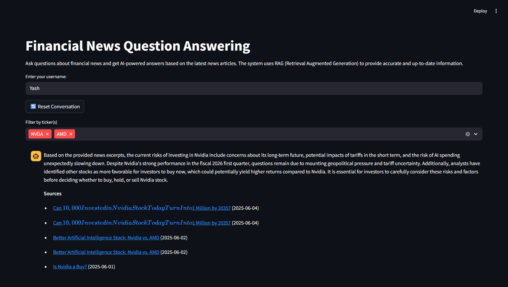
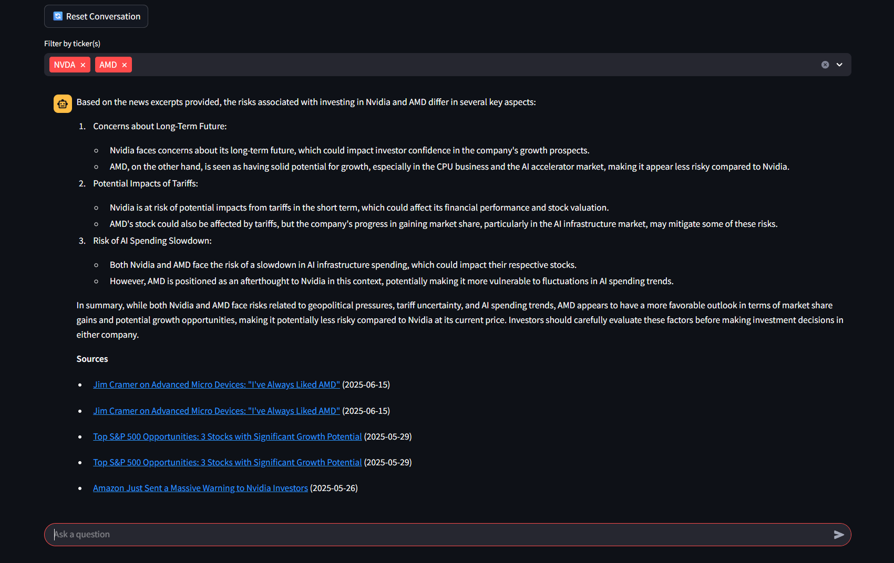
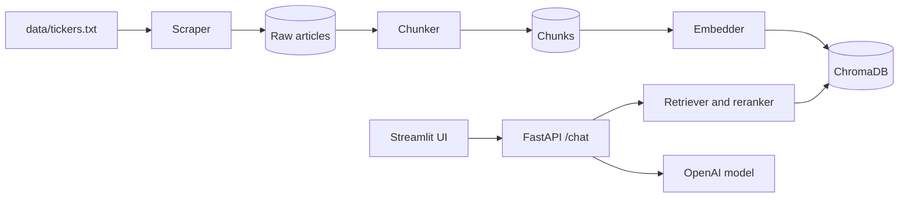

# Financial News Agent

A question-answering assistant for financial news. It scrapes recent news from [Finviz](https://finviz.com) for a list of stock tickers, indexes the articles in a vector database, and answers questions with an OpenAI model. Every answer comes with the articles it drew on.


## Features

- **News collection.** Scrapes Finviz news for the tickers in `data/tickers.txt` and skips articles it has already saved.
- **Semantic search.** Embeds article text with `BAAI/bge-base-en-v1.5`, stores it in ChromaDB, and reranks results by recency and ticker relevance.
- **Grounded answers.** Answers only from the retrieved articles, using `gpt-4o-mini` by default, and returns their titles, links and dates.
- **Conversation memory.** Uses earlier messages in the same conversation to answer follow-up questions.
- **Scheduled updates.** Optionally refreshes the data every day while the API server is running.
- **Two interfaces.** A Streamlit chat app and a FastAPI REST API.

## Demo




## How it works



1. **Scrape.** The Scrapy spider fetches each ticker's Finviz news page. For articles hosted on Finviz, it also downloads the full text and publication date.
2. **Chunk.** Article bodies are cleaned and split into chunks of about 800 characters, overlapping by 200.
3. **Embed.** New chunks are embedded and added to ChromaDB. Chunks removed from the chunks file are deleted from the index.
4. **Answer.** For each question, the 15 most similar chunks are reranked by recency, ticker match and length. The top 5 go into the prompt, together with relevant earlier messages from the conversation.

## Quick start

**Requirements:**
- Python 3.11 or later
- An OpenAI API key
- About 440 MB of disk space for the embedding model, which is downloaded from Hugging Face the first time articles are embedded

### 1. Install

```bash
git clone https://github.com/Yahlawat/Financial-News-Agent.git
cd Financial-News-Agent

python3 -m venv .venv
source .venv/bin/activate

# Quotes are required in zsh
pip install -e ".[scraper,api,ui,rag]"
```

### 2. Configure

```bash
cp .env.example .env
```

Open `.env` and set `OPENAI_API_KEY`. All other settings have defaults; see [Configuration](#configuration).

### 3. Choose tickers

List one ticker per line in `data/tickers.txt`. Lines starting with `#` are ignored.

```bash
mkdir -p data
printf "AAPL\nMSFT\nGOOGL\nTSLA\n" > data/tickers.txt
```

### 4. Build the index

```bash
finnews-pipeline
```

This command removes old articles, scrapes new ones, then chunks and embeds them. The first run takes longer while the embedding model downloads.

### 5. Start the app

Start the API in one terminal and the web interface in another:

```bash
finnews-api   # http://localhost:8000
finnews-ui    # http://localhost:8501
```

Open http://localhost:8501 to chat. The web interface sends questions to the API, so the API must be running.

## Usage

### Commands

| Command | Description |
|---------|-------------|
| `finnews-pipeline` | Run the full pipeline: cleanup, scrape, chunk, embed. |
| `finnews-scrape` | Scrape news only. Use `--tickers AAPL,MSFT` to override `data/tickers.txt`. |
| `finnews-chunk` | Split scraped articles into chunks. |
| `finnews-embed` | Add new chunks to the vector database and remove deleted ones. |
| `finnews-cleanup` | Remove articles older than 30 days. Use `--days N` to change the cutoff. |
| `finnews-api` | Start the FastAPI server. |
| `finnews-ui` | Start the Streamlit web interface. |

If the API is running when you run `finnews-embed` or `finnews-pipeline` from the command line, restart the API afterwards so it picks up the changes.

### REST API

```bash
curl -X POST http://localhost:8000/chat \
  -H "Content-Type: application/json" \
  -d '{"question": "What is the latest news on Apple?", "user_id": "default", "conversation_id": "demo"}'
```

```json
{
  "conversation_id": "demo",
  "user_id": "default",
  "question": "What is the latest news on Apple?",
  "answer": "...",
  "sources": [
    {"title": "...", "url": "https://finviz.com/news/...", "published_date": "2026-10-15T09:28:00"}
  ]
}
```

| Endpoint | Description |
|----------|-------------|
| `POST /chat` | Answer a question. Optional fields: `tickers` (defaults to `data/tickers.txt`), `top_k` (articles, default 5) and `chat_k` (earlier messages, default 3). |
| `GET /health` | Check that the server and vector stores are ready. |
| `GET /scrape/status` | Show the current or last pipeline run. |
| `POST /scrape/tickers/metadata` | Show scraping metadata for a list of tickers. |

Interactive API documentation is available at http://localhost:8000/docs.

### Scheduled updates

To refresh the data daily, set `SCRAPE_SCHEDULE_ENABLED=true` in `.env`. While `finnews-api` is running, it then runs the full pipeline every day at 02:00 UTC. You can change the time with `SCRAPE_SCHEDULE_HOUR` and `SCRAPE_SCHEDULE_MINUTE`. New articles become searchable as soon as the run finishes, without restarting the server.

## Configuration

Settings are read from `.env` or from environment variables with the same names.

| Setting | Default | Description |
|---------|---------|-------------|
| `OPENAI_API_KEY` | (none) | Required. OpenAI API key. |
| `LLM_MODEL` | `gpt-4o-mini` | OpenAI model used for answers. |
| `EMBEDDING_MODEL` | `BAAI/bge-base-en-v1.5` | Hugging Face embedding model. |
| `API_HOST` / `API_PORT` | `127.0.0.1` / `8000` | API server address. |
| `STREAMLIT_PORT` | `8501` | Web interface port. |
| `SCRAPE_SCHEDULE_ENABLED` | `false` | Run the daily pipeline from the API server. |

See [docs/RUNBOOK.md](docs/RUNBOOK.md#configuration) for the full list.

## Project structure

```
Financial-News-Agent/
├── src/finnews/
│   ├── api/        # FastAPI server
│   ├── ui/         # Streamlit web interface
│   ├── rag/        # Chunking, embedding, retrieval and answer generation
│   ├── scraper/    # Scrapy spider, scheduler and run status
│   ├── scripts/    # Command-line entry points
│   └── common/     # Configuration, logging and file utilities
├── data/           # Tickers, articles, vector databases (created at runtime)
├── tests/
└── docs/
```

## Documentation

- [docs/RUNBOOK.md](docs/RUNBOOK.md): configuration reference, operations, data retention, logs and troubleshooting
- [docs/STRUCTURE.md](docs/STRUCTURE.md): architecture, modules, data formats and design decisions
- [tests/README.md](tests/README.md): test suite layout and how to run it

## Development

```bash
pip install -e ".[scraper,api,ui,rag,dev]"
pytest
```

The tests mock network access, OpenAI and the embedding model, so they run offline without an API key.

## Limitations

- **Headline-only articles aren't searchable.** Only articles hosted on Finviz have their full text scraped. Links to other sites are saved with their headline and source but aren't embedded, so answers can't use them.
- **Finviz layout changes can break the scraper.** The scraper depends on Finviz's page layout.
- **Single-user, no authentication.** The app is designed for one user and has no login. The API listens on `127.0.0.1` by default; don't expose it publicly without adding authentication.
- **Not financial advice.** Answers summarize news coverage and are not investment advice.

## License

Released under the MIT License. See [LICENSE](LICENSE).

Author: Yash Ahlawat
