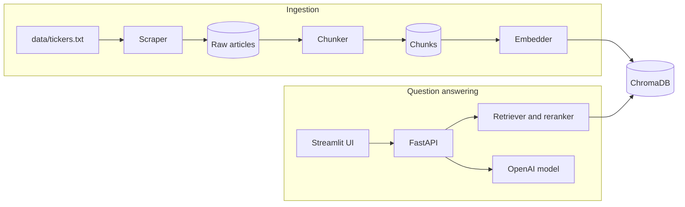

<h1 align="center">Financial News Agent</h1>

<p align="center">
  Ask questions about the latest news on your stocks and get answers grounded in cited articles.
</p>

<p align="center">
  
  <a href="LICENSE"></a>
  
</p>

<p align="center">
  
</p>

## Overview

Following the news for several stocks means reading dozens of articles a day. Financial News Agent does that reading for you:
- **Collects** recent news for the tickers you choose from [Finviz](https://finviz.com).
- **Indexes** the articles in a vector database.
- **Answers** questions with a retrieval-augmented generation (RAG) pipeline.

Each answer is based only on the retrieved articles and links back to them, so every claim can be checked against its source.

## Table of contents

- [Features](#features)
- [Tech stack](#tech-stack)
- [Architecture](#architecture)
- [Getting started](#getting-started)
- [Usage](#usage)
- [Configuration](#configuration)
- [Project structure](#project-structure)
- [Development](#development)
- [Known limitations](#known-limitations)
- [License](#license)

## Features

- **Automated news collection.** Scrapes Finviz news for every ticker in `data/tickers.txt` and skips articles it has already saved.
- **Semantic search with reranking.** Retrieves the most relevant article chunks, then reranks them by recency and ticker relevance.
- **Cited answers.** Returns an answer together with the title, link and date of each source article.
- **Conversation memory.** Uses earlier messages in the same conversation to answer follow-up questions.
- **Scheduled refresh.** Optionally runs the full data pipeline every day from the API server.
- **Chat interface and REST API.** Comes with a Streamlit web app for interactive use and a FastAPI service for integrations.

## Tech stack

| Area | Tools |
|------|-------|
| Scraping | Scrapy |
| Embeddings | Hugging Face `BAAI/bge-base-en-v1.5` via sentence-transformers |
| Vector database | ChromaDB |
| LLM orchestration | LangChain, OpenAI (`gpt-4o-mini` by default) |
| API and scheduling | FastAPI, Uvicorn, APScheduler |
| Interface | Streamlit |
| Tooling | pytest, Ruff, Black, isort, pre-commit |

## Architecture



1. **Scrape.** For each ticker, the spider collects the news listed on Finviz. Articles hosted on Finviz are downloaded in full, with their publication date.
2. **Chunk.** Article text is cleaned and split into overlapping chunks of about 800 characters.
3. **Embed.** New chunks are embedded and stored in ChromaDB. Chunks that were removed from the chunks file are deleted from the index.
4. **Answer.** The 15 chunks closest to the question are reranked, and the top 5 go into the prompt along with relevant earlier messages from the conversation.

See [docs/STRUCTURE.md](docs/STRUCTURE.md) for module-level details and design decisions.

## Getting started

### Prerequisites

- Python 3.11 or later
- An [OpenAI API key](https://platform.openai.com/api-keys)
- About 440 MB of free disk space for the embedding model, which is downloaded on first use

### Installation

```bash
git clone https://github.com/Yahlawat/Financial-News-Agent.git
cd Financial-News-Agent

python3 -m venv .venv
source .venv/bin/activate

pip install -e ".[scraper,api,ui,rag]"
```

### Configuration

```bash
cp .env.example .env
```

Set `OPENAI_API_KEY` in `.env`. Every other setting has a default.

Then list the tickers to follow, one per line:

```bash
mkdir -p data
printf "AAPL\nMSFT\nGOOGL\nTSLA\n" > data/tickers.txt
```

### Build the index

```bash
finnews-pipeline
```

This command scrapes, chunks and embeds the news for your tickers. The first run also downloads the embedding model.

### Run

Start the API, then the web interface, in separate terminals:

```bash
finnews-api   # http://localhost:8000
finnews-ui    # http://localhost:8501
```

Open http://localhost:8501 and ask a question, for example *"What are the main risks facing Nvidia right now?"*

## Usage

### Command-line tools

| Command | Description |
|---------|-------------|
| `finnews-pipeline` | Run the full pipeline: cleanup, scrape, chunk and embed. |
| `finnews-scrape` | Scrape news only. Use `--tickers AAPL,MSFT` to override `data/tickers.txt`. |
| `finnews-chunk` | Split scraped articles into chunks. |
| `finnews-embed` | Sync the vector database with the chunks file. |
| `finnews-cleanup` | Remove articles older than 30 days. Use `--days N` to change the cutoff. |
| `finnews-api` | Start the REST API. |
| `finnews-ui` | Start the web interface. |

> [!NOTE]
> The API loads the vector database when it starts. After running `finnews-embed` or `finnews-pipeline` from the command line, restart the API to pick up the changes. Scheduled runs don't need a restart.

### REST API

```bash
curl -X POST http://localhost:8000/chat \
  -H "Content-Type: application/json" \
  -d '{"question": "What is the latest news on Apple?", "user_id": "default", "conversation_id": "demo"}'
```

```json
{
  "conversation_id": "demo",
  "user_id": "default",
  "question": "What is the latest news on Apple?",
  "answer": "...",
  "sources": [
    {"title": "...", "url": "https://finviz.com/news/...", "published_date": "2026-10-15T09:28:00"}
  ]
}
```

| Endpoint | Description |
|----------|-------------|
| `POST /chat` | Answer a question. Optional fields: `tickers` (defaults to `data/tickers.txt`), `top_k` (articles, default 5) and `chat_k` (earlier messages, default 3). |
| `GET /health` | Report whether the server and vector stores are ready. |
| `GET /scrape/status` | Report the progress of the current or last pipeline run. |
| `POST /scrape/tickers/metadata` | Return the last scrape time and article count for each given ticker. |

Interactive documentation is served at http://localhost:8000/docs.

### Scheduled refresh

Set `SCRAPE_SCHEDULE_ENABLED=true` in `.env`. The API server then runs the full pipeline every day at 02:00 UTC, which you can change with `SCRAPE_SCHEDULE_HOUR` and `SCRAPE_SCHEDULE_MINUTE`. New articles become searchable as soon as the run finishes.

## Configuration

Settings are read from `.env` or from environment variables with the same names. The most commonly changed settings are:

| Setting | Default | Description |
|---------|---------|-------------|
| `OPENAI_API_KEY` | (none) | Required. OpenAI API key. |
| `LLM_MODEL` | `gpt-4o-mini` | OpenAI model used to write answers. |
| `EMBEDDING_MODEL` | `BAAI/bge-base-en-v1.5` | Hugging Face model used for embeddings. |
| `API_HOST` / `API_PORT` | `127.0.0.1` / `8000` | API server address. |
| `STREAMLIT_PORT` | `8501` | Web interface port. |
| `SCRAPE_SCHEDULE_ENABLED` | `false` | Run the pipeline daily from the API server. |

See the [configuration reference](docs/RUNBOOK.md#configuration) for all settings.

## Project structure

```
Financial-News-Agent/
├── src/finnews/
│   ├── api/        # FastAPI application
│   ├── ui/         # Streamlit web interface
│   ├── rag/        # Chunking, embedding, retrieval and answer generation
│   ├── scraper/    # Scrapy spider, scheduler and run status
│   ├── scripts/    # Command-line entry points
│   └── common/     # Configuration, logging and file utilities
├── tests/          # pytest suite
├── docs/           # Runbook and architecture documentation
└── data/           # Tickers, articles and vector databases (created at runtime)
```

## Development

Install the development dependencies and the pre-commit hooks:

```bash
pip install -e ".[scraper,api,ui,rag,dev]"
pre-commit install
```

Run the test suite:

```bash
pytest
```

The tests mock all external services, so they run offline without an API key. See [tests/README.md](tests/README.md) for the layout and conventions.

Further documentation:

- [docs/RUNBOOK.md](docs/RUNBOOK.md): configuration reference, operations, data retention, logs and troubleshooting
- [docs/STRUCTURE.md](docs/STRUCTURE.md): architecture, data formats and design decisions

## Known limitations

- **Only Finviz-hosted articles are searchable.** Finviz lists many articles from other sites, but only the ones it hosts itself are scraped in full. Links to other sites are saved with just their headline and aren't used in answers.
- **The scraper depends on Finviz's page layout.** Changes to that layout can break it.
- **Single-user, without authentication.** The API listens on `127.0.0.1` by default and shouldn't be exposed publicly without an authentication layer in front of it.

## License

Distributed under the MIT License. See [LICENSE](LICENSE) for details.

## Disclaimer

This project summarizes publicly available news for informational purposes only. It is not investment advice.
